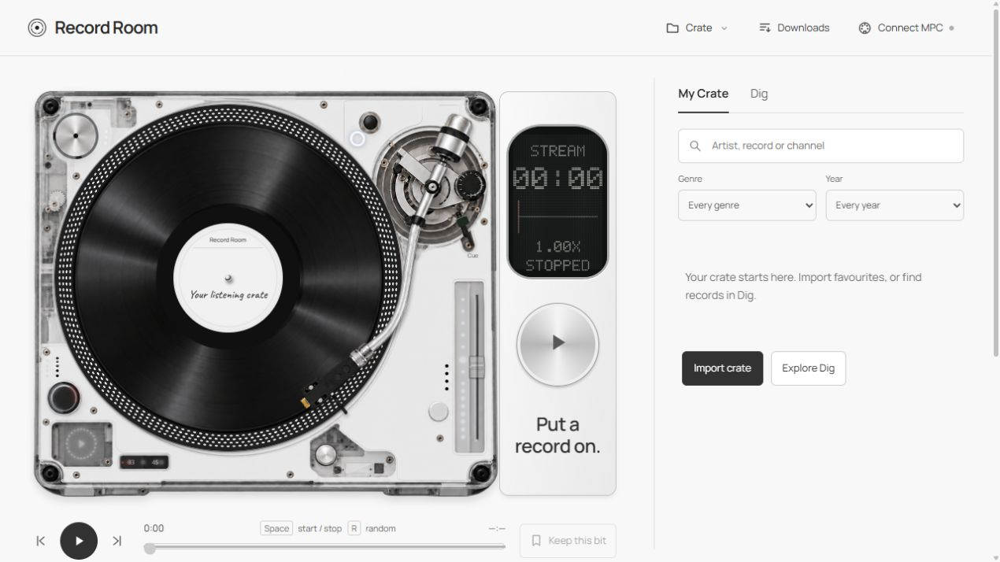
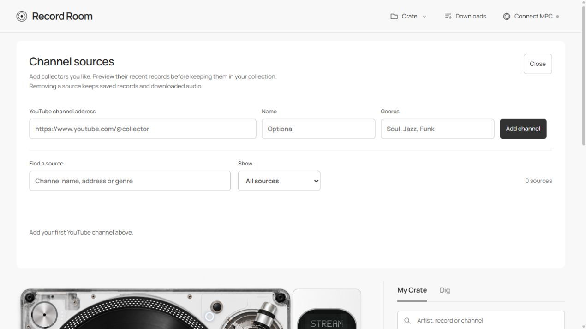

# Record Room

**Pick a record. Drop the needle. Find your next sample.**

Record Room brings vinyl digging to your computer: a turntable, your personal crate, and fresh records from YouTube collectors. Listen with your mouse, keyboard, or MPC pads and Q-Links.

## Get the app

[**Get Record Room →**](https://github.com/diamond-one/record-room/releases)

Desktop builds target **Windows** (installer or portable), **macOS** (Apple Silicon and Intel), and **Linux** (AppImage or application folder). Available downloads appear on the Releases page.

The desktop app includes its local service, downloader and audio converter. Python, Node.js and FFmpeg do not need separate installation. Discovery, streaming and new downloads need internet; completed audio stays on your computer.



## Start digging

1. Open **Dig → Source → Manage channels** and add a YouTube collector, or choose **Crate → Import crate** to bring your favourites.
2. Click a record to play it. Move the tonearm or click the grooves to explore.
3. Press **Add to crate** to keep the record, or **Keep this bit** to save a timestamp.

New installs start with an empty collection. Your records and channel lists stay yours.

**My Crate** holds saved records. **Dig** presents up to ten discoveries. Both have search, Genre and Year filters. **Keep digging** or **D** replaces the discoveries without interrupting the record on the deck.

Selecting a record starts it. Finished records advance through the current filtered view, wrapping at the end. Manual Stop and held-pad auditions do not advance. Reopening restores your selection without starting music.

Confirmed unavailable uploads disappear from My Crate, Dig, channel previews, and the download list. Their IDs stay excluded after restarts, rescans, and reimports. Connection failures and embedding restrictions remain retryable.

## Choose your record collection folder

Open **Downloads → Choose folder…**. **Open folder** opens it in your file manager. You can also paste a full path and press **Use folder**.

The choice survives restarts. Changing it affects future downloads; existing audio stays available in its previous location. Finish or cancel pending downloads before changing folders. Files are FLAC, named by their YouTube ID.

**Download audio** saves the current record. **Crate → Download this crate** queues records shown by your filters. Downloads are explicit; opening the app never starts them. The queue shows progress, cancellation and individual retries.

Downloaded or attached audio enables continuous linked pitch/speed, motor spin-up and braking, analysed grooves, and the dot-matrix waveform. Streaming uses YouTube’s speed steps. Source restrictions still apply; the app does not use browser cookies or bypass access controls.

## Manage channels

Open **Crate → Channel sources**, or **Dig → Source → Manage channels**.



- **Add:** paste a YouTube channel address. Name and genres are optional.
- **Preview:** browse up to ten recent cached records; select one to audition and select it again to pause.
- **Edit:** correct an address or change its name/genre hints.
- **Remove:** remove a source, with **Undo removal** available. Saved records and downloaded audio remain.

Search and filter sources to find working feeds or addresses needing attention. Channel-list JSON import is also supported. Public feeds expose recent uploads rather than complete histories. Channel genres are broad hints; years come from clear years in video titles, never upload dates.

## Play it from an MPC

Open **Connect MPC**, choose the MIDI input, then **Learn all 16**. Tap and release Pads 1–16 in order on one bank. Select a pad in the diagram to relearn it.

| Control | Action |
| --- | --- |
| Pads 1–12 | Twelve evenly spaced needle drops. |
| Pad 13 | Hold a random drop; release to stop immediately. |
| Pad 14 | Hold to play the current position; release to stop immediately. |
| Pad 15 | Stop immediately. |
| Pad 16 | Start/stop. |
| Q-Link 1 | Scan the record, or a 30-second window. |
| Q-Link 2 | Linked pitch and speed for local audio. |

Pad 1 is bottom-left; Pad 13 is top-left. Learning verifies releases for momentary pads, rejects conflicts and saves profiles per input. Cancel preserves the previous complete profile. The app receives MIDI only.

For MPC1000/JJOS3: **MIDI OUT A → adapter IN**, active track output **1A**, and two distinct Q-Link MIDI CC numbers. Use **Learn Scan** and **Learn Pitch**. [JJOS3 Q-Link guide](https://www7a.biglobe.ne.jp/~mpc1000/128xl/qlink_v2_os3_e.htm)

Windows includes the input-only MIDI bridge. macOS and Linux use the desktop browser engine’s MIDI support. Downloaded audio gives the tightest response; streaming adds latency.

## Keyboard controls

| Key | Action |
| --- | --- |
| Space | Start/stop |
| R | Random record |
| D | Keep digging |
| 0–9 | Beginning, then 10–90% |
| Left / Right | Nudge the needle |
| M | Keep a moment |

Shortcuts leave text fields and native form navigation alone.

## Back up your crate

**Crate → Export crate** backs up favourites, moments, exclusions, and MIDI mappings. **Import crate** accepts Record Room backups and Sample Digging favourites JSON. Audio and artwork files are separate from the JSON backup; thumbnails load from YouTube.

Desktop settings live in the operating system’s application-data folder, separate from the installed app and your audio folder. Personal crates, MIDI profiles and downloaded recordings are excluded from source control and installers.

<details>
<summary><strong>Run or build from source</strong></summary>

Development requires Node.js 22+ and Python 3.12.

```text
npm ci
python -m pip install -r desktop/requirements-build.txt
python desktop/build-resources.py
npm start
```

Create native installers with `npm run dist` on each target operating system. The **Desktop builds** GitHub Actions workflow tests and builds Windows, Apple Silicon macOS, Intel macOS and Linux. It runs manually or for a version tag.

For browser mode, run `python server.py --port 8771` and open `http://127.0.0.1:8771/`. This mode needs its downloader tools separately and accepts a pasted collection-folder path.

```text
npm test
python -m unittest discover -s tests -p "test_*.py"
```

</details>

## Credits

The deck is inspired by SL-1200 controls and [Sungwoo Choi’s independent Turntable(1) concept](https://nothing.community/d/57859-product-design-concept-turntable1), using artwork supplied for this project. Record Room is not endorsed by Sample Digging, Nothing, Technics, Akai, Roland or Native Instruments.

Self-hosted Manrope and Caveat use the SIL Open Font License; licences are in `assets/`. Desktop runtime and audio-tool notices ship in the app’s resources.
